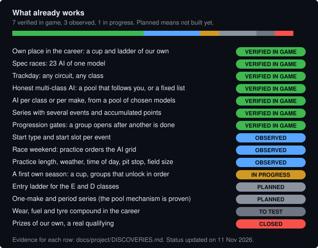
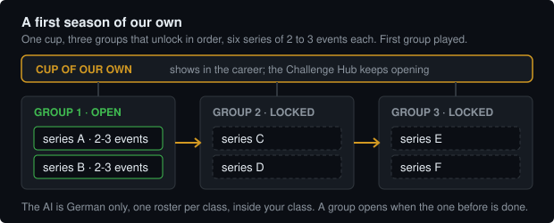
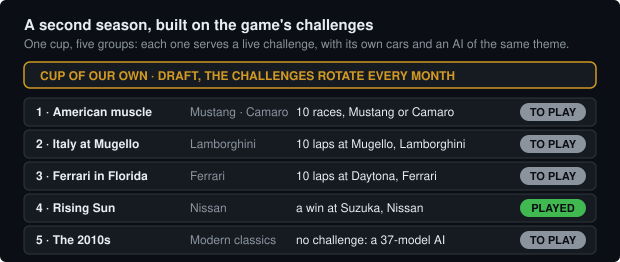

<!-- docs_check: historical -->
<!-- Public README. Source: publish/public/README.md in the private lab; validated by publish.py in the export. -->
<p align="center">
  
</p>

<p align="center">
  <b>A career mod for Forza Motorsport (2023, Steam) — and the tools to build it on your machine</b><br>
  Forza Motorsport 4 meets Gran Turismo 4, one piece at a time, each one tested in game
</p>

<p align="center">
  
  
  
  
  
  
</p>

<p align="center">
  <a href="docs/en/PROGRESS.md"><b>Progress</b></a> ·
  <a href="docs/en/GETTING_STARTED.md"><b>Build your own</b></a> ·
  <a href="docs/en/MOD_TOOLKIT.md">What the mod can do</a> ·
  <a href="docs/guides/CAREER_MOD.md">The vision</a> ·
  <a href="docs/INDICE.md">All docs</a> ·
  <a href="docs/pt-br/PROGRESS.md">Português</a>
</p>

---

## Proven in game

Not a plan: each line below ran in the game and has its evidence in [DISCOVERIES](docs/project/DISCOVERIES.md).

- **A 23-car spec race**: all Porsche 911 GT3 RS '23, or all Subaru BRZ '22, against you.
- **An AI that stays in your class**: German cars only, one roster per class, C to S, whatever the player drives.
- **A grid of the models you pick**: five chosen models fill all 23 slots, four or five of each.
- **An AI of one theme, at any size**: American only, Italian only, 2010s only; pools of 4, 12, 21 and 37 models, each
  filling the whole grid.
- **A series with several events** that run in order, add up points and close at the last one.
- **A cup of our own** whose groups unlock only after the one before is done.
- **Our series count toward the game's own challenges**: car, track and laps, one for one, and the **real prize arrives**
  (ten races in a Mustang gave the Mustang; a win at Suzuka in a Nissan unlocked the Nissan; ten laps at Daytona in a Ferrari gave a Ferrari 488 GTB, and a second challenge on that track, a segment score, paid a Porsche 911 RSR with no extra work).
- **Where you start, how long you practise, the weather and the pit stop**, set event by event.
- **And the honest limit:** credits and cars come from the **server**, so we cannot edit prizes, but a series built for a live
  challenge earns the game's own prize. We mapped what cannot be edited, so you do not have to test it again ([ECONOMY_MAP](docs/reference/ECONOMY_MAP.md)).

The full timeline, phase by phase: [PROGRESS](docs/en/PROGRESS.md).

<p align="center">
  
</p>

> Independent fan project, not affiliated with Microsoft, Turn 10 or the Forza
> brand. This repository contains **our own code and documentation only** — no
> game files, no game text, no mod payloads. See [NOTICE](NOTICE.md).

## The goal

A career that takes the best of two games: the **permanent event list**, the right car for each event and one-make series of
**Forza Motorsport 4**, and the **climb from the entry classes** of **Gran Turismo 4**, with short cheap races in ordinary cars
first. Nothing is distributed ready to install: you generate your own changes with the tools here, from the game you own, by
editing its content cache **on your machine**. Every change is reproducible and reversible: lint, mandatory dry-run, automatic
backup, post-write verification and rollback.

| stage | state |
|---|---|
| Own place in the career, spec races, trackday, honest multi-class AI | verified in game |
| AI per class or make; series with several events; progression gates | verified in game |
| Own AI pools of a theme (country, make, decade); series that serve the game's live challenges | verified in game |
| Start type and slot, race weekend, practice length, weather, pit stop, field size | observed |
| A first own season (a cup, three groups that unlock in order) | in progress |
| A second season built around the game's live challenges (a cup, five groups) | in progress |
| Entry ladder (E and D), one-make and period series | planned |
| Wear, fuel, tyre compound | to test |
| Prizes of our own, a real qualifying | closed (the server grants prizes; no data field selects a qualifying) |

## A first season of our own

<p align="center">
  
</p>

A cup of our own, in the career, with three groups of two series (two or three events each). The AI is German only and sits in
your class. The first group is played; the other two stay locked until it is done. How it works:
[CAREER_MOD](docs/guides/CAREER_MOD.md).

## A second season, built on the game's challenges

The game keeps a list of monthly challenges: ten races in a Mustang, ten laps at Mugello in a Lamborghini, a win at Suzuka in
a Nissan. We built a cup of five groups, **one group per challenge**, each with its own car list, its own AI of the same theme
and the track the challenge asks for. The cup is applied in the game and shows in the career. Two groups were played end to
end. At Suzuka the AI is all Japanese, the win counted and the Nissan was unlocked. At Daytona the AI is all Ferrari, the laps
counted and the Ferrari 488 GTB arrived, together with a Porsche 911 RSR from a second challenge on the same track. The
Italian, Camaro and 2010s groups are still to play. Because the challenges rotate every month, the cup is a draft whose themes follow the list of
the day.

<p align="center">
  
</p>

## Try it in three steps

1. **Look** — build the two oracles and read your own career data on a *copy*
   of the cache: [GETTING_STARTED](docs/en/GETTING_STARTED.md) (about 15
   minutes, never touches the game).
2. **Describe** — write a short JSON spec for the series or grid you want
   ([specs/README.md](specs/README.md), [specs/_TEMPLATE.json](specs/_TEMPLATE.json)).
3. **Apply** — `--dry-run`, then apply with `--verify` with the game closed;
   undo with `rollback_cache.py` ([PIPELINE](docs/en/PIPELINE.md)).

```powershell
python _tools\build_series.py --spec specs\<name>.json       # spec -> kit
python _tools\cache_edit.py --dry-run --plan patches\<kit>\plan.json
python _tools\cache_edit.py --plan patches\<kit>\plan.json --verify
python _tools\rollback_cache.py                              # undo the last apply
```

### Prerequisites

- Windows, with the game launched at least once (it creates the CmsCache).
- Python 3.10+ (`pip install -r requirements.txt`) and the .NET 10 SDK (the two
  oracles target `net10.0`).
- The CMS key and the third-party files the cache oracle needs, obtained by you
  and kept git-ignored: [THIRD_PARTY](docs/project/THIRD_PARTY.md). A fresh clone
  cannot run `cache_edit.py` until you supply them.

## You want to…

| you want to… | status | start here |
|---|---|---|
| rename, reorder or unlock cups, ladders and series | verified | [tutorial 01](docs/tutorials/01_rename.md) · [tutorial 02](docs/tutorials/02_reorder.md) |
| create a new series from a spec | verified | [tutorial 03](docs/tutorials/03_new_series.md) · [SERIES_CHECKLIST](docs/reference/SERIES_CHECKLIST.md) |
| build an AI grid (class, make, chosen models) | verified | [tutorial 04](docs/tutorials/04_ai_grid.md) · [AI_GRIDS](docs/guides/AI_GRIDS.md) |
| set where you start, practice, weather, start type per event | observed | [RACE_SYSTEM](docs/reference/RACE_SYSTEM.md) |
| understand how the career pays | mapped | [ECONOMY_MAP](docs/reference/ECONOMY_MAP.md) |
| see every lever and how sure we are | mapped | [MOD_TOOLKIT](docs/en/MOD_TOOLKIT.md) · [MODDING_SURFACE](docs/reference/MODDING_SURFACE.md) |

**What this does not do.** It does not touch online play, physics or the account economy. Steam's *verify files* or a new
server snapshot can undo edits; run the tools again (kits are reproducible). A new CMS file with an invented id is rejected by
the game, so custom content reuses existing slots. Findings marked *observed* rest on one or two runs: if yours differs, open an
issue with the numbers ([CONTRIBUTING](CONTRIBUTING.md)).

## Documentation

| folder | what is inside |
|---|---|
| [`docs/en/`](docs/en/GETTING_STARTED.md) · [`docs/pt-br/`](docs/pt-br/GETTING_STARTED.md) | **Start**: getting started, concepts, the apply pipeline, the mod toolkit, progress |
| [`docs/tutorials/`](docs/tutorials/01_rename.md) | **Step by step**: rename, reorder, new series, AI grid |
| [`docs/guides/`](docs/guides/CAREER_MOD.md) | **By goal**: the career mod, career basics, AI grids, troubleshooting |
| [`docs/reference/`](docs/reference/MODDING_SURFACE.md) | **The format**: what can be modded, career model, race system, cars and PI, schema, economy, glossary |
| [`docs/data/`](docs/data/ENUMS.md) | **Tables** generated from your game: cars, tracks, classes and enums |
| [`docs/project/`](docs/project/DISCOVERIES.md) | **The project**: discoveries, open questions, career audit, decisions, third-party material |

The full map, by task: [docs/INDICE.md](docs/INDICE.md). The role of each script:
[_tools/TOOLS.md](_tools/TOOLS.md).

**For AI agents:** start at [okf/index.md](okf/index.md), an
[Open Knowledge Format](https://github.com/GoogleCloudPlatform/knowledge-catalog/tree/main/okf)
bundle of the rules, tools, specs and docs, with one index per folder. It is
generated; do not edit it by hand.

## Golden rules

1. **Game closed** before any cache write. The game locks the files; a write
   while it is open leaves the cache inconsistent.
2. The runtime source is the **CmsCache**
   (`%LOCALAPPDATA%\Microsoft.ForzaMotorsport\CmsCache\`), not the install
   folder.
3. Always `--dry-run` first, then apply with `--verify`. Every apply backs up
   first; the tools refuse to run if you skip these.
4. Never commit the key, third-party tools or copies of game files.
5. Nothing here changes online play: the project only touches what the career
   reads. Global switches, physics and the account economy are out of scope.

Modding violates the game's Terms of Use and may get you banned from online
features. Use it at your own risk.

## What is not in this repository

- Game files, game text or mod payloads: you generate your own kits from the
  game you own.
- The CMS key and any part of the
  [Forza Mod Tool](https://github.com/HTTPJXRDN/Forza-Mod-Tool) (it declares no
  license, so nothing of it is redistributed): [THIRD_PARTY](docs/project/THIRD_PARTY.md).
- The maintainer's private research log, applied-kit history and one-off
  generators. The method they produced is what is documented here.

## Contributing

Run the pipeline on a copy and report what breaks, build a series nobody tried,
or settle an [open question](docs/project/OPEN_QUESTIONS.md) — each names the
experiment that decides it. See [CONTRIBUTING](CONTRIBUTING.md), the
[CODE_OF_CONDUCT](CODE_OF_CONDUCT.md) and [SECURITY](SECURITY.md) (what never to
post). History: [CHANGELOG](CHANGELOG.md).

This repository is a filtered publication of a private lab; accepted changes
are ported there by the maintainer.

## License

Code: [MIT](LICENSE). Documentation: [CC BY 4.0](LICENSE-DOCS.md). Third-party
material is not covered and not distributed: [THIRD_PARTY](docs/project/THIRD_PARTY.md).
