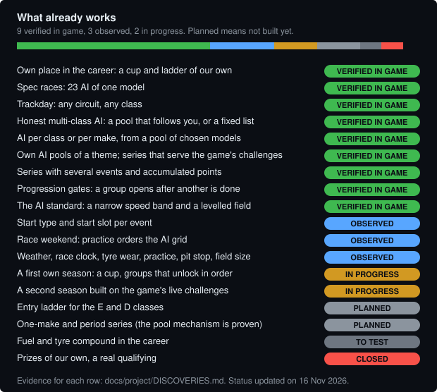
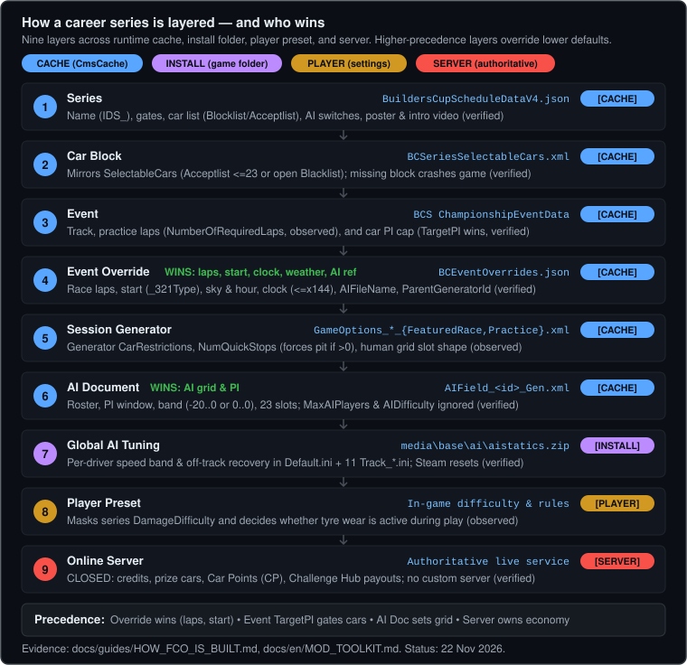
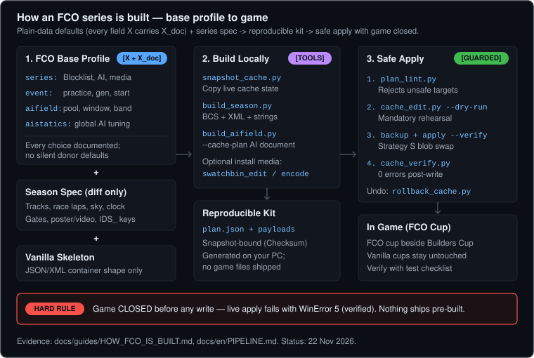

<!-- docs_check: historical -->
<!-- Public README. Source: publish/public/README.md in the private lab; validated by publish.py in the export. -->
<p align="center">
  
</p>

<p align="center">
  <b>A career mod for Forza Motorsport (2023, Steam) — and the tools to build it on your machine</b><br>
  Forza Motorsport 4 meets Gran Turismo 4, one piece at a time, each one tested in game
</p>

<p align="center">
  
  
  
  
  
  
</p>

<p align="center">
  <a href="#for-players"><b>For Players</b></a> ·
  <a href="#for-modders--technical-overview"><b>For Modders</b></a> ·
  <a href="docs/en/PROGRESS.md"><b>Progress</b></a> ·
  <a href="docs/en/GETTING_STARTED.md"><b>Build your own</b></a> ·
  <a href="docs/en/MOD_TOOLKIT.md">What the mod can do</a> ·
  <a href="docs/INDICE.md">All docs</a> ·
  <a href="docs/pt-br/PROGRESS.md">Português</a>
</p>

---

> Independent fan project, not affiliated with Microsoft, Turn 10 or the Forza
> brand. This repository contains **our own code and documentation only** — no
> game files, no game text, no mod payloads. See [NOTICE](NOTICE.md).

---

## For players

### What is Forza Career Overhaul (FCO)?

Forza Career Overhaul (FCO) adds a **permanent career cup of our own** inside
*Forza Motorsport (2023, Steam)* alongside the vanilla Builders Cup. Your
vanilla cups and multiplayer modes stay untouched.

The design takes the best of two classic career structures:

- **Forza Motorsport 4:** a permanent event list that never rotates away, the
  right car for each event, and one-make or themed grids.
- **Gran Turismo 4:** climbing from entry classes in ordinary cars through
  regional, one-make, and endurance championships.

### What already exists in game

Every feature below has been built and played in game; evidence records live in
[DISCOVERIES](docs/project/DISCOVERIES.md) and [PROGRESS](docs/en/PROGRESS.md):

- **The Intro Series (built on our base profile, verified/observed):** FCO's
  first flagship series inside its own cup — open car eligibility via blocklist
  (every car except disruptive class X prototypes), 23 AI opponents following your
  car's PI under our AI standard (narrowed driver speed band and gentler
  off-track recovery so AI leaves the track far less), custom series poster art,
  a full-screen intro video, a 3-minute timed rain cycle at Brands Hatch (real
  seconds), a day-to-night cycle at Le Mans (clock at x144), and dry morning
  practice separate from the race.
- **Themed grids & multi-event seasons (verified):** spec races of 23 cars of
  one model, Trackday events, AI pools filtered by class, make, country, or
  decade, progression gates between series and groups, and series that count
  toward live Challenge Hub rewards.
- **Optional visual mods for the install (observed on one machine):** render
  quality, car level of detail, track look, rain drops, camera tweaks (credits
  to **Better Photo mode** by **GmSV2**), and a transparent photo-mode
  watermark, aimed at high-end PCs ([INSTALL_VISUAL_MODS](docs/reference/INSTALL_VISUAL_MODS.md)).

<p align="center">
  
</p>

See the full phase-by-phase story in [PROGRESS](docs/en/PROGRESS.md) and the
career vision in [CAREER_MOD](docs/guides/CAREER_MOD.md).

### What cannot be changed (honest limits)

We tested the edges of what game data controls so players know upfront what is
off-limits:

- **Credits, prize cars, and Car Points (CP) belong to the server (verified/observed):**
  editing payout tables, bonuses, challenge targets, or car-level CP curves only
  changes what screens display; the online service grants credits and cars
  against its own challenge list ([ECONOMY_MAP](docs/reference/ECONOMY_MAP.md)).
  *(Workaround that works today: FCO series built on matching cars/tracks count
  1:1 toward live Challenge Hub challenges, verified.)*
- **No offline mode and no custom server (closed):** the client checks a
  cryptographic signature on every response from the online service. This project
  does not support, document, or assist with redirecting traffic or faking
  server replies.
- **Nothing changes while the game is running (verified):** writing to the
  cache while Forza Motorsport is open fails immediately with `WinError 5`
  (access denied) because the game locks its cache files. The game must always
  be **closed** before applying edits.
- **No brand-new AI roster files (observed) and no separate qualifying (observed):**
  custom grids reuse existing unused or repointed vanilla AI slots; career
  events use timed practice (ordering AI) plus the start-position screen (or
  generator grid shape) for the player.

### Current status & installer plan

- **Today:** nothing is distributed pre-built or ready-to-install. If you want
  to try FCO right now, you generate and apply kits locally on your PC using the
  command-line tools in this repository (see [For modders](#for-modders--technical-overview)
  below).
- **Planned (not built yet):** a player-facing **Rust installer/launcher** that
  ships our plain-data base profile and season specs and rebuilds FCO directly
  against your game's local cache with no game files distributed.

### Risk & Terms of Use

> **Warning:** Modding violates the game's Terms of Use and may get you banned
> from online features. Use at your own risk. Nothing here modifies multiplayer
> or physics, and traffic redirection / server spoofing is explicitly out of
> scope and unsupported.

---

## For modders — technical overview

### Architecture: layers and who wins

Every career series is assembled from nine layers spanning the runtime content
cache (`%LOCALAPPDATA%\Microsoft.ForzaMotorsport\CmsCache\`), the game install
folder, the player's difficulty preset, and the online server:

<p align="center">
  
</p>

- **Full architecture guide:** [HOW_FCO_IS_BUILT](docs/guides/HOW_FCO_IS_BUILT.md)
- **Every lever & evidence label:** [MOD_TOOLKIT](docs/en/MOD_TOOLKIT.md) · [MODDING_SURFACE](docs/reference/MODDING_SURFACE.md) · [SERIES_FIELD_VALUES](docs/reference/SERIES_FIELD_VALUES.md)

### Base profile & build-to-apply pipeline

Instead of cloning a vanilla donor series and silently inheriting hidden caps
or broken AI flags, every FCO series is built from a plain-data **base profile**
where every field `X` carries a sibling `X_doc` explanation, combined with a
minimal season spec and a vanilla skeleton used strictly for JSON/XML shape:

<p align="center">
  
</p>

#### Try it in three steps

1. **Look** — build the two `.NET` oracles and inspect your own career data on a
   *copy* of the cache: [GETTING_STARTED](docs/en/GETTING_STARTED.md) (~15 minutes,
   never touches the live game).
2. **Describe** — write a short JSON spec for the series or AI grid you want
   ([specs/README.md](specs/README.md), [specs/_TEMPLATE.json](specs/_TEMPLATE.json)).
3. **Apply** — run `plan_lint.py` and `--dry-run`, close the game, apply with
   `--verify`, and undo anytime with `rollback_cache.py` ([PIPELINE](docs/en/PIPELINE.md)).

```powershell
python _tools\snapshot_cache.py                                  # copy live cache
python _tools\build_series.py --spec specs\<name>.json           # spec -> kit
python _tools\plan_lint.py --plan <kit_dir>\plan.json            # safety lint
python _tools\cache_edit.py --dry-run --plan <kit_dir>\plan.json # mandatory dry-run
python _tools\cache_edit.py --plan <kit_dir>\plan.json --verify  # apply (game CLOSED)
python _tools\cache_verify.py                                    # 0 errors expected
python _tools\rollback_cache.py                                  # restore last backup
```

#### Prerequisites

- **Windows**, with *Forza Motorsport* launched at least once (creates `CmsCache`).
- **Python 3.10+** (`pip install -r requirements.txt`) and the **.NET 10 SDK**
  (the two oracles target `net10.0`).
- **User-supplied third-party files:** the CMS AES key and cache oracle
  dependencies obtained by you and kept git-ignored ([THIRD_PARTY](docs/project/THIRD_PARTY.md)).
  A fresh clone cannot run `cache_edit.py` until you supply them.

### You want to…

| goal | status | start here |
|---|---|---|
| understand how FCO series are built from the base profile | verified | [HOW_FCO_IS_BUILT](docs/guides/HOW_FCO_IS_BUILT.md) |
| rename, reorder or unlock cups, ladders and series | verified | [tutorial 01](docs/tutorials/01_rename.md) · [tutorial 02](docs/tutorials/02_reorder.md) |
| create a new series from a spec | verified | [tutorial 03](docs/tutorials/03_new_series.md) · [SERIES_CHECKLIST](docs/reference/SERIES_CHECKLIST.md) |
| build an AI grid (class, make, chosen models, one doc per grid) | verified | [tutorial 04](docs/tutorials/04_ai_grid.md) · [AI_GRIDS](docs/guides/AI_GRIDS.md) |
| apply global AI driving/recovery tuning | verified / observed | [AI_STATICS](docs/reference/AI_STATICS.md) |
| set start slot, practice, weather timing, race clock (x144), tyre wear, start type | observed | [RACE_SYSTEM](docs/reference/RACE_SYSTEM.md) |
| give a series its own poster or full-screen intro video | verified / observed | [SWATCHBIN](docs/reference/SWATCHBIN.md) · [INTRO_VIDEO](docs/reference/INTRO_VIDEO.md) · [INSTALL_INDEX](docs/reference/INSTALL_INDEX.md) |
| understand how the career pays and what is server-owned | mapped | [ECONOMY_MAP](docs/reference/ECONOMY_MAP.md) |
| apply visual modifications to the install (render, LOD, camera, watermark) | observed (one machine) | [INSTALL_VISUAL_MODS](docs/reference/INSTALL_VISUAL_MODS.md) · [MEDIA_MAP](docs/reference/MEDIA_MAP.md) |
| see every lever and evidence label | mapped | [MOD_TOOLKIT](docs/en/MOD_TOOLKIT.md) · [MODDING_SURFACE](docs/reference/MODDING_SURFACE.md) |

### Documentation map

| folder | what is inside |
|---|---|
| [`docs/en/`](docs/en/GETTING_STARTED.md) · [`docs/pt-br/`](docs/pt-br/GETTING_STARTED.md) | **Start:** getting started, concepts, apply pipeline, mod toolkit, progress |
| [`docs/tutorials/`](docs/tutorials/01_rename.md) | **Step by step:** rename, reorder, new series, AI grid |
| [`docs/guides/`](docs/guides/HOW_FCO_IS_BUILT.md) | **By goal:** how FCO is built, career mod vision, career basics, AI grids, troubleshooting |
| [`docs/reference/`](docs/reference/MODDING_SURFACE.md) | **Reference:** modding surface, field values, race system, AI statics, install index, visual mods, economy, schema, glossary |
| [`docs/data/`](docs/data/ENUMS.md) | **Tables** generated from your game: cars, tracks, classes and enums |
| [`docs/project/`](docs/project/DISCOVERIES.md) | **Project:** discoveries, open questions, career audit, ADRs, third-party material |

Full task index: [docs/INDICE.md](docs/INDICE.md) · Script roles: [_tools/TOOLS.md](_tools/TOOLS.md) · Sample poster art (CC BY 4.0): [art/posters](art/posters/fco_sample_poster_848x1320.png).

**For AI agents:** start at [okf/index.md](okf/index.md), an
[Open Knowledge Format](https://github.com/GoogleCloudPlatform/knowledge-catalog/tree/main/okf)
bundle of the rules, tools, specs and docs (generated; do not edit by hand).

### Golden rules

1. **Game CLOSED before any cache or install write.** The game locks cache blobs;
   writing while open fails with `WinError 5` and leaves the cache inconsistent.
2. **Runtime source is `CmsCache`** (`%LOCALAPPDATA%\Microsoft.ForzaMotorsport\CmsCache\`),
   not the install's seed folder (`ADR-004`).
3. **Always `--dry-run` first, then apply with `--verify`.** Every apply creates
   an automatic backup; the tools refuse to run if you skip safety checks.
4. **Never commit the CMS key, third-party tools, or plain-text copies of game files.**
5. **No multiplayer, physics, account economy, or server spoofing.** This project
   only edits career content read from `CmsCache` and local install visual/AI
   files. It does not document, test, or support traffic redirection or custom
   servers.

---

## What is not in this repository

- Game files, game text, or pre-built mod payloads: you generate your own kits
  from the game you own.
- The CMS key and any part of the
  [Forza Mod Tool](https://github.com/HTTPJXRDN/Forza-Mod-Tool) (it declares no
  license, so nothing of it is redistributed): [THIRD_PARTY](docs/project/THIRD_PARTY.md).
- The maintainer's private research logs, applied-kit history, and one-off
  lab generators. The verified method and public tools are what live here.

## Contributing

Run the pipeline on a cache copy and report what breaks, build a series from a
spec, or settle an [open question](docs/project/OPEN_QUESTIONS.md) — each names
the experiment that decides it. See [CONTRIBUTING](CONTRIBUTING.md), the
[CODE_OF_CONDUCT](CODE_OF_CONDUCT.md), and [SECURITY](SECURITY.md) (what never
to post). Release history: [CHANGELOG](CHANGELOG.md).

This repository is a filtered export from a private lab; accepted changes are
ported back by the maintainer.

## License

Code: [MIT](LICENSE). Documentation: [CC BY 4.0](LICENSE-DOCS.md). Third-party
material is not covered and not distributed: [THIRD_PARTY](docs/project/THIRD_PARTY.md).
