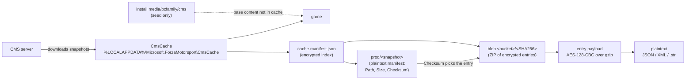
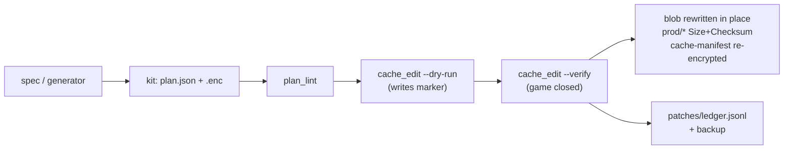
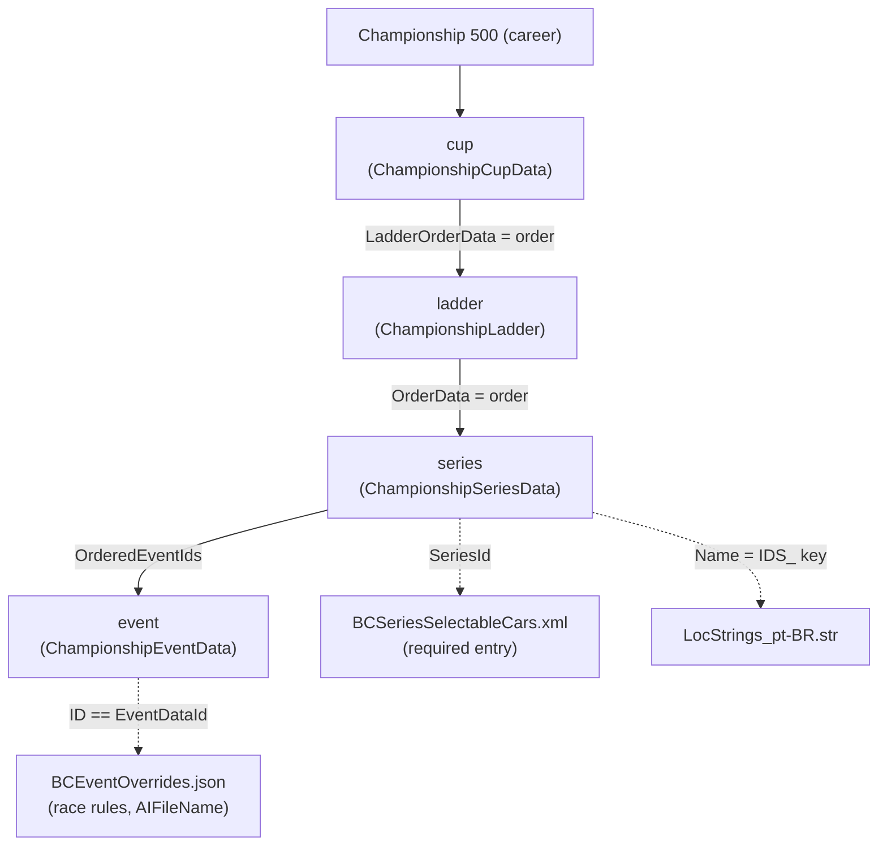

# Concepts

> 🌐 [Português](../pt-br/CONCEPTS.md) · **English**

How Forza Motorsport (2023) stores its career, and how this project changes
it.

## 1. Where the game reads content from

- The **CmsCache is the runtime source**. Editing the install or `mediapc/`
  has no effect.
- There are **two snapshots** (`20251124t234605pkod` old, `20260923t185113xwyk`
  live) with same-shaped blobs. Entries are matched **by Checksum**, never by
  name or mtime.
- Every `Size`/`Checksum` describes the **encrypted** bytes.

## 2. How a mod is applied (Strategy S)

**Strategy S**: blobs are content-addressed (`name == sha256(content)`), but
the game accepts a blob whose name no longer matches its content. So we keep
the file name and update only `Size` and `Checksum` in the manifests. `Path`
and `Id` are never changed. Each changed entry is re-encrypted with the
**current encrypted payload as template**, so the gzip settings and every
untouched entry stay byte-identical.

## 3. The career model (`BuildersCupScheduleDataV4.json`)

- Championship **1** (Featured Multiplayer) lives in
  `RacersCupMetaDataV4.json` and is never touched (`plan_lint` enforces it).
- Invariants: `ladder.OrderData == ids of its series`, `OrderedEventIds ==
  events` and unique ids. The save marks completion by `EventDataId`, so
  **event ids are never reused** (`patches/ids_retired.json`).
- Custom ranges: series ≥ 20000, events 65897900–65899999.

## 4. Glossary

| term | meaning |
|---|---|
| **snapshot** | one server version of the content (`prod/<name>`); kits are snapshot-bound |
| **ContentGroup** | GUID grouping logical files; a group maps to one blob per snapshot |
| **logical file** | an entry such as `BuildersCupScheduleDataV4.json` inside a blob |
| **payload** | the encrypted bytes of one logical file (AES-128-CBC, IV=0, over gzip) |
| **template** | the current encrypted payload, passed to `cmsoracle enc` to keep its settings |
| **Strategy S** | keep blob names, update `Size`/`Checksum` only |
| **kit** | `patches/<kit>/`: `plan.json` + `.enc` payloads + the kit's notes file |
| **plan** | list of targets for `cache_edit.py` (`bytes`, `json`, `json_raw`) |
| **IDS_ key** | localized-string key; new keys = `IDS_<md5("MC44|<label>")>` |
| **spec** | `specs/<name>.json`, declarative description of a new series |
| **ledger** | `patches/ledger.jsonl`, one line per real apply |
