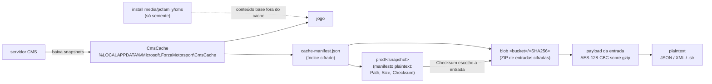
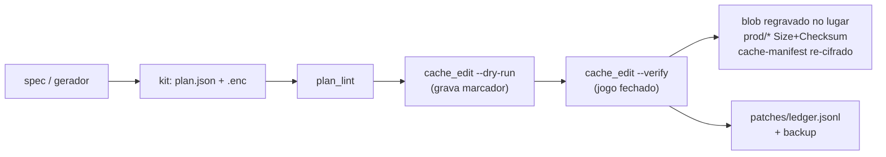
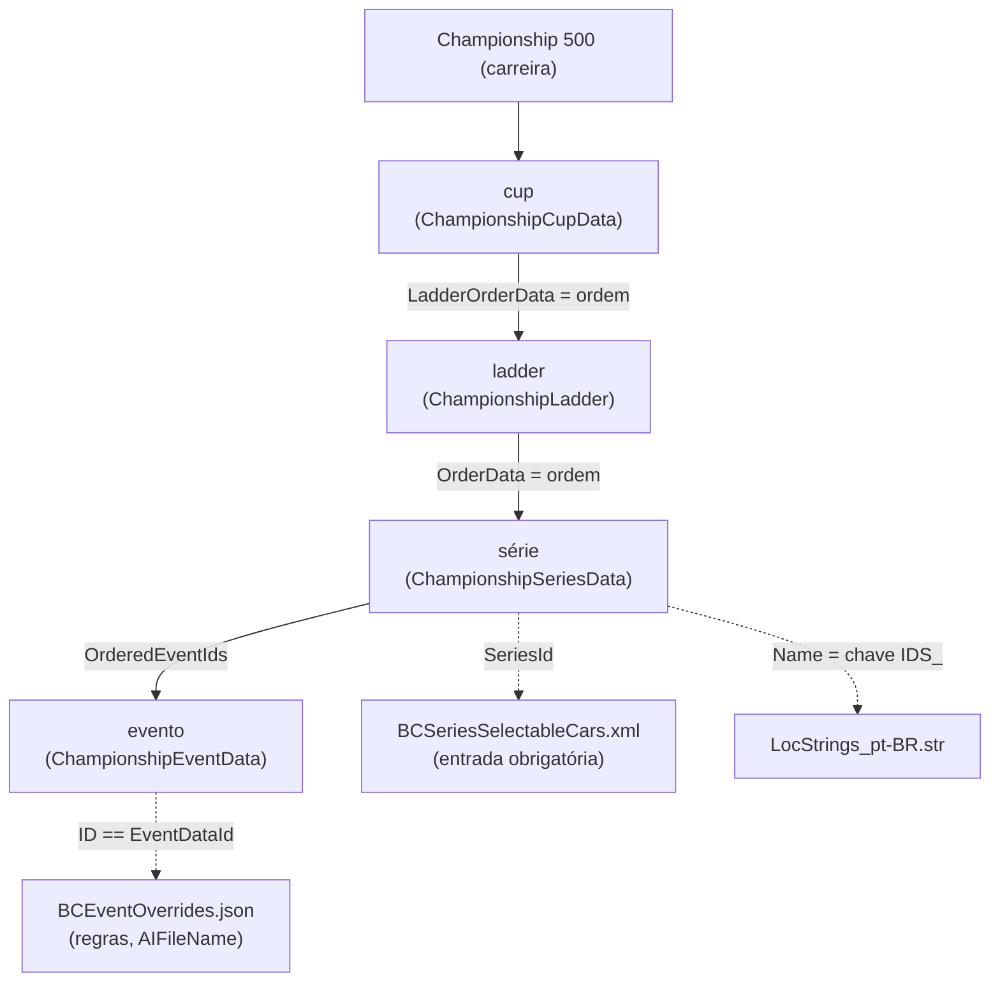

# Conceitos

> 🌐 **Português** · [English](../en/CONCEPTS.md)

Como o Forza Motorsport (2023) guarda a carreira e como este projeto a
modifica.

## 1. De onde o jogo lê o conteúdo

- O **CmsCache é a fonte em runtime**. Editar o install ou o `mediapc/` não
  tem efeito.
- Existem **duas snapshots** (`20251124t234605pkod` antiga,
  `20260923t185113xwyk` live) com blobs de mesmo formato. A entrada é
  escolhida **pelo Checksum**, nunca por nome ou mtime.
- Todo `Size`/`Checksum` descreve os bytes **cifrados**.

## 2. Como um mod é aplicado (Strategy S)

**Strategy S**: os blobs são endereçados por conteúdo
(`nome == sha256(conteúdo)`), mas o jogo aceita um blob cujo nome já não bate
com o conteúdo. Por isso mantemos o nome do arquivo e só atualizamos `Size` e
`Checksum` nos manifestos. `Path` e `Id` nunca mudam. Cada entrada alterada é
re-cifrada usando o **payload cifrado atual como template**, o que preserva as
configurações do gzip e deixa as entradas não tocadas byte-idênticas.

## 3. O modelo da carreira (`BuildersCupScheduleDataV4.json`)

- O campeonato **1** (Multijogador em Destaque) fica em
  `RacersCupMetaDataV4.json` e nunca é tocado (o `plan_lint` garante).
- Invariantes: `ladder.OrderData == ids das suas séries`,
  `OrderedEventIds == eventos` e ids únicos. O save marca conclusão por
  `EventDataId`, então **ids de evento nunca são reutilizados**
  (`ids_retired.json` (na pasta `patches`)).
- Faixas custom: séries ≥ 20000, eventos 65897900–65899999.

## 4. Glossário

| termo | significado |
|---|---|
| **snapshot** | uma versão do conteúdo vinda do servidor (`prod/<nome>`); kits valem só para a snapshot em que foram gerados |
| **ContentGroup** | GUID que agrupa arquivos lógicos; mapeia para um blob por snapshot |
| **arquivo lógico** | entrada como `BuildersCupScheduleDataV4.json` dentro de um blob |
| **payload** | bytes cifrados de um arquivo lógico (AES-128-CBC, IV=0, sobre gzip) |
| **template** | payload cifrado atual, passado ao `cmsoracle enc` para manter as configurações |
| **Strategy S** | manter o nome dos blobs, atualizar só `Size`/`Checksum` |
| **kit** | `patches/<kit>/`: `plan.json` + payloads `.enc` + the kit's notes file |
| **plano** | lista de alvos para o `cache_edit.py` (`bytes`, `json`, `json_raw`) |
| **chave IDS_** | chave de texto localizado; chaves novas = `IDS_<md5("MC44|<rótulo>")>` |
| **spec** | `specs/<nome>.json`, descrição declarativa de uma série nova |
| **ledger** | `patches/ledger.jsonl`, uma linha por apply real |
